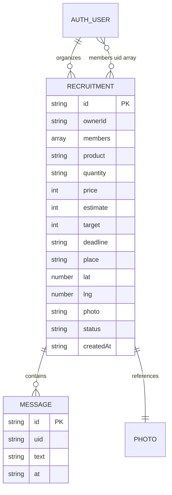

# 데이터 모델

| 저장소 | 경로 | 규칙 |
| --- | --- | --- |
| Firebase Auth | SDK 관리 uid | 비밀번호 별도 저장 금지 |
| Firestore | recruitments/{uid_requestId} | ownerId 포함 중복 없는 members, 1≤인원≤target |
| Firestore | recruitments/{id}/messages/{uid_requestId} | matched 참여자만 Callable 접근 |
| Storage | recruitmentPhotos/{uid}/{requestId} | 본인 생성만, 5MB 이하 image, 수정·삭제 차단 |

정원·마감 인덱스는 firestore.indexes.json에 정의.
createdAt/deadline/at는 정규화된 UTC ISO 문자열로 저장한다.
단일 인원 배열은 목표 최대 100명인 MVP에 맞춘 결정. 별도 참여 컬렉션으로 분리할 때 트랜잭션 불변식을 유지한다.
미사용 업로드 파일 정리·탈퇴 데이터 정책은 운영 전 설계한다.
